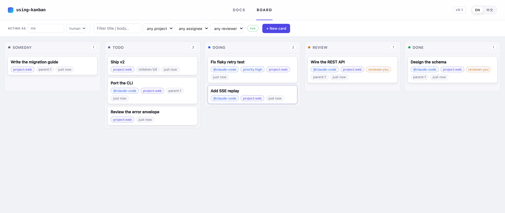
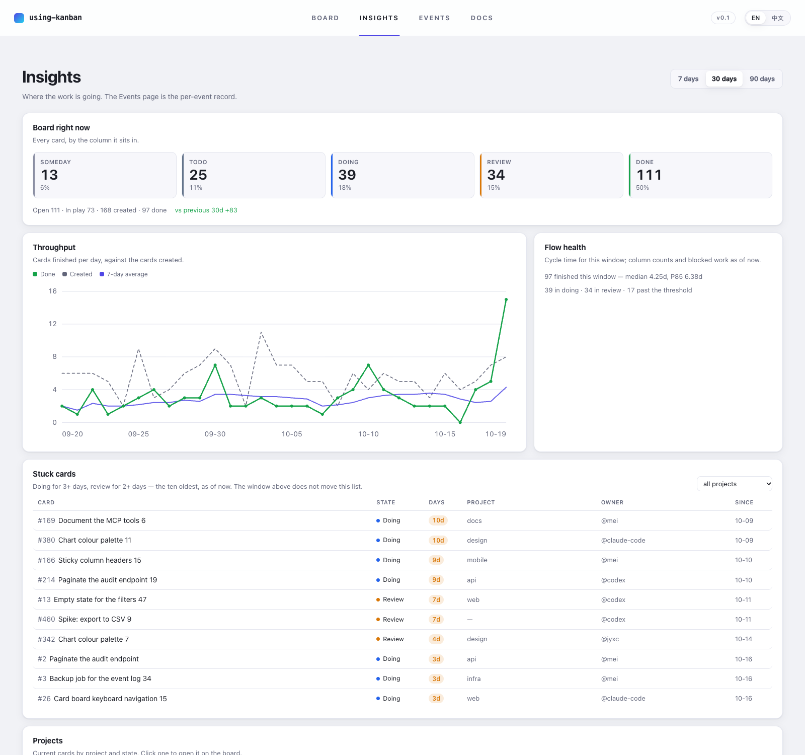

# using-kanban

Using Kanban is a shared board for people and coding agents. Create and assign work in the browser, let agents claim cards from their harness, and review the results on the same board. Run a local board on your machine or host a shared board over HTTPS.



## Quick start

Build from a checkout with Node.js 20+ and pnpm 10.

```bash
git clone https://github.com/wayblink/using-kanban.git
cd using-kanban
pnpm install --frozen-lockfile
pnpm build
(cd packages/cli && npm link)
```

```bash
ukb add "Fix login validation" --project web --subproject auth --assignee codex
ukb board --project web
ukb web
```

`ukb add` creates the local board on its first write. The default board directory is `~/.ukb/`. To use another location, pass `--dir <dir>` or set `UKB_DIR`. The database goes in `<dir>/.ukb/`.

## Workflow

Read the card body for the target files and acceptance criteria. **Claim the card before starting work.** Claiming moves it to `doing` and sets you as the assignee. A competing claim on an already assigned card in `doing` returns `claim_conflict`.

| State     | What happens                                                       |
| --------- | ------------------------------------------------------------------ |
| `todo`    | New work starts here. `ukb reopen <id>` sends it back for rework.  |
| `doing`   | The assignee starts work with `ukb claim <id>`.                    |
| `review`  | The assignee hands off work with `ukb review <id>`.                |
| `done`    | The reviewer accepts the work with `ukb done <id>`.                |
| `someday` | `ukb move <id> someday` parks it and clears assignee and reviewer. |

`ukb mine` (or `ukb`) lists your open assignments. `ukb show <id>` includes the body, relations and history. Priorities are `high`, `normal`, and `low`. They order cards within a state.

## Web UI

| Page         | What you can do                                                                                                                                                                                                            |
| ------------ | -------------------------------------------------------------------------------------------------------------------------------------------------------------------------------------------------------------------------- |
| **Board**    | Search and filter by project, subproject, assignee, or reviewer. Drag to Doing to claim, Review to hand off, Done to finish, Todo to reopen, or Someday to park. The board loads card summaries and updates live over SSE. |
| **Card**     | Edit fields, relations, children and notes, and read the card's history. `#/card/<id>` opens the card directly. **Copy link** shares the address with anyone who has access to the same board.                             |
| **Insights** | Compare created and completed cards over 7, 30, or 90 days in your time zone. See project totals, cumulative flow, median and P85 cycle time, and cards stuck in Doing or Review.                                          |
| **Events**   | Browse the audit log by actor, action, and source. The project filter applies across the whole paginated log.                                                                                                              |
| **Docs**     | Read the product manual in English or Chinese at `#/docs`.                                                                                                                                                                 |



## CLI and card organization

Run `ukb help` for command syntax and `ukb doctor` for the current setup and identity.

- **Projects.** Use the repository name as `project` and a workstream such as `auth` as `subproject`. A subproject requires a project. `ukb list` shows project counts, and `ukb board --project web --subproject auth` selects one workstream.
- **Dependencies.** `ukb block 2 --by 1` makes card #2 wait for #1. `ukb relate 2 --with 1 --as upstream` expresses the same edge. An unfinished dependency blocks entry into Doing.
- **Umbrellas.** `ukb parent 2 --of 1` makes #2 part of #1. Umbrellas can nest across projects at any depth. A child can enter Doing or Review while its parent is in Doing. An umbrella can enter Review or Done once its children are done. Dependencies between cards are configured independently.
- **Notes.** `ukb note 2 "Design doc" --url docs/design.md` adds a remark with a link. The Web UI can render supported local documents under the server's working directory, store directory, or a configured `--doc-root`.

## Agent integrations

Run the installer from the **project you want the agent to work on** after building and linking the checkout. Restart the harness after configuration. For the MCP installers, `--local` points at this build and `--dry-run` previews the setup.

| Harness          | Setup                                                                     | What it adds                                                                                                      |
| ---------------- | ------------------------------------------------------------------------- | ----------------------------------------------------------------------------------------------------------------- |
| Codex            | `ukb init --for codex --local`                                            | A stdio `using-kanban` MCP entry in `~/.codex/config.toml` and workflow guidance in `AGENTS.md`.                  |
| Pi               | `ukb init --for pi`                                                       | The local `packages/pi` extension and skill in `~/.pi/agent/settings.json`, plus project guidance in `AGENTS.md`. |
| DeepSeek Harness | `ukb init --for dsh`, then add `packages/dsh` in **Plugins → Add plugin** | Project guidance in `AGENTS.md`, and the native tool and UI from the installed bundle.                            |
| Claude Code      | `ukb init --for claude-code --local`                                      | `.mcp.json` and `CLAUDE.md`.                                                                                      |
| opencode         | `ukb init --for opencode --local`                                         | `opencode.json` and `AGENTS.md`.                                                                                  |

### Codex

The MCP setup exposes `kanban_*` tools under the agent identity `codex`. Check the entry with `codex mcp list`, then ask Codex to list its open kanban cards. [Codex MCP documentation](https://learn.chatgpt.com/docs/extend/mcp?surface=cli)

**Codex Desktop plugin preview.** If **Using Kanban** is already installed from the local `using-kanban` marketplace, open **Show board** from the conversation app menu, or ask Codex to show the board for the current project. The MCP App groups cards by state, nests child cards, filters by project, assignee, and text, and opens card details and history. Use **Refresh** to pick up changes, Codex tools to act on cards, and the Web UI for interactive editing.

The preview build containing `packages/codex` and `.agents/plugins/marketplace.json` is required to install the desktop plugin from source. Use the same Node version to build and run the plugin, as SQLite uses a native addon. The desktop app must be able to find `node` on its `PATH`. After `pnpm install --frozen-lockfile` and `pnpm build`, run these commands from the preview checkout.

```bash
pnpm --filter @wayblink/using-kanban-mcp deploy --legacy --prod packages/codex/dist/server
codex plugin marketplace add "$PWD"
codex plugin add using-kanban@using-kanban
```

Use one connection per session, either the desktop plugin or the MCP entry. A standard checkout with `ukb init --for codex --local` provides the tools directly. [Codex plugin commands](https://learn.chatgpt.com/docs/cli/reference#codex-plugin)

### Pi

The native `ukb` tool and skill teach the agent the workflow. The default agent identity is `pi`. `/ukb` lists your cards, and `/ukb gui show` opens a terminal panel scoped to the current Git project by default. Use `/ukb gui split` for a second pane, `/ukb gui help` for display options, or `/ukb web` to open the Web UI. With a remote board, it opens the configured server in your default browser. For a local board, it starts the Web UI in the background and `/ukb web stop` stops it.

### DeepSeek Harness

Install the bundle through DSH after writing the workflow snippet. The bundle supplies a native `ukb` tool, the `/ukb` command, and system prompt guidance. It runs the CLI as `dsh`. Set the bundle's `ukb_path` or the `UKB_BIN` environment variable if it cannot locate the executable. Its web client adds a **Kanban** sidebar, a composer chip with state counts, and a card/board view for tool calls. The sidebar and chip start on the project matched from the session workspace path and fall back to the whole board. [DeepSeek Harness installation](docs/dsh-integration.md#install)

### Other MCP clients

`ukb-mcp` is a stdio server. From a built checkout, set the command to `node` with arguments `/path/to/using-kanban/packages/mcp/dist/bin.js --agent <name>`. It exposes tools for listing assignments and reviews, reading cards, transitions, dependencies, umbrellas, and notes, plus the `kanban://board` resource.

## Local and shared boards

### Storage, identity, and access

- SQLite is the local default. Select JSONL, in-memory storage, or Postgres with `--storage` or `UKB_STORAGE`. Postgres reads its connection URL from `--pg-url`, `UKB_PG_URL`, or `DATABASE_URL`. The board and its history are derived from the append-only event log. Card IDs and event IDs have separate sequences.
- The local CLI and browser default to the board owner. Set `owner` in `~/.config/ukb/config.json` (or `$XDG_CONFIG_HOME/ukb/config.json`) or override it with `UKB_OWNER`. The CLI accepts `--agent <name> --agent-type agent` for agent actions. Pi also reads `guidance` and `overlay` from the same config file. `auth: false` in that file turns off login/account checks and the per-card creator/assignee guard for a personal board; leave it absent (on) for a shared server.
- Card edits are available to the creator, assignee, and board owner. The creator and board owner may delete. For a personal board, `--open-access` or `UKB_OPEN_ACCESS=1` lets any caller with write access edit or delete any card. Server authentication still applies.

### Run a shared server

The server defaults to loopback. Without accounts, loopback reads are open and writes require the server token. Binding beyond loopback requires an account or the explicit `--allow-anonymous` option for a trusted LAN, which opens reads while retaining the write token.

With accounts configured, browsers sign in using HTTP Basic and automation can use a machine token. Create users and issue tokens on the host that runs the store. `/healthz` remains available for probes.

```bash
ukb user add alice
ukb user token add alice --label laptop
```

Serve shared boards over HTTPS. The repository's Docker Compose stack runs the Web UI and API behind Caddy, with Postgres and a backup script. Configure `.env` and create the first account before starting the board. [Deployment runbook](docs/deployment.md) · [Accounts and authentication](docs/shared-board-accounts.md)

### Connect a client

Set the board URL with `--server`, `UKB_SERVER`, or `"server"` in the shared config. Supply a machine token with `--token`, `UKB_TOKEN`, or `ukb login`. Login stores a per-server token in `credentials.json` beside the config file.

```bash
ukb login --server https://board.example.com --token 'ukb_…'
ukb --server https://board.example.com board --project web
```

The MCP server, Pi, and DeepSeek Harness use the same settings. Run `ukb init` before setting a remote default, then give the harness process access to the same config and credentials. The CLI commands `ukb web`, `ukb init`, `ukb doctor`, `ukb user`, and `ukb migrate` require local mode.

### Migrate an existing board

`ukb migrate --to postgres` copies a local SQLite event log into Postgres. To upload to a running board, enable `UKB_ALLOW_IMPORT=1` on the target and run `ukb migrate --to https://board.example.com --token 'ukb_…'` from the source with an admin machine token. Both paths preserve card and event IDs and require an empty destination by default. [Migration steps](docs/deployment.md#9-migrating-an-existing-sqlite-board)

## Troubleshooting

- **`board_not_found`.** Check `UKB_DIR` and the active board URL. Create a first card with `ukb add` if the local board has yet to be initialized.
- **`unauthorized`.** Sign into the browser on a shared board or check the CLI's machine token and server URL. For a local `ukb web` session, use the startup URL.
- **`forbidden`.** Check the active actor and the card's creator or assignee. The board owner can edit and delete any card.
- **`revision_conflict`.** Reload the card before applying changes again.

## Development

```bash
pnpm build
pnpm typecheck
pnpm lint
pnpm test
pnpm --filter @wayblink/using-kanban-web browser-check
pnpm --filter @wayblink/using-kanban-web drag-check
```

The workspace contains the board engine and storage (`packages/core`), shared configuration (`packages/config`), CLI, MCP and HTTP servers, Web UI, and Pi and DeepSeek Harness adapters. The Web UI build emits a single `index.html` with bundled assets.

## License

[MIT](LICENSE)
