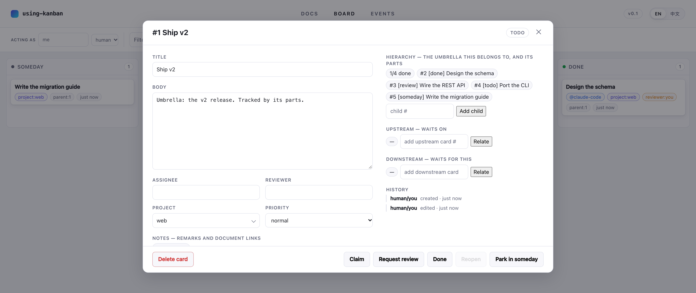

# using-kanban

> A kanban for agents and the operator who steers them.
> One board, on this machine or a server you control: a CLI, an MCP server, an HTTP API and a Web UI.

An operator and several agents (Claude Code, Codex, opencode, Pi, DeepSeek Harness, …) share one
board. The operator sets the work and reviews it; the agents claim cards, do
them, and hand them back. Underneath is a small event-sourced engine — the CLI,
MCP server, HTTP API and Web UI are all thin clients of the same core — so you
can embed the board in another product or build your own front end. No teams,
no daemon: the board is the coordination.


## Quick start

The packages aren't on npm yet, so run from a checkout:

```bash
git clone https://github.com/wayblink/using-kanban.git
cd using-kanban
pnpm install && pnpm build
npm link ./packages/cli        # puts `ukb` on your PATH
```

```bash
ukb add "Write the OpenAPI spec" --project api --reviewer you
ukb add "Implement /api/cards" --project api --assignee claude-code
ukb board                      # the whole board
ukb web                        # → the Web UI, in a browser
```

Then point your agent at it — this writes the MCP config and a workflow snippet
the harness will actually read:

```bash
ukb init --for claude-code     # or: codex | opencode | pi | dsh
```

## The board

Five columns: `someday | todo → doing → review → done`.

| Column    | Meaning                  | How you get there       |
| --------- | ------------------------ | ----------------------- |
| `someday` | parked — meant, not now  | `ukb move <id> someday` |
| `todo`    | ready to pick up         | created here            |
| `doing`   | someone is working on it | `ukb claim <id>`        |
| `review`  | waiting for its reviewer | `ukb review <id>`       |
| `done`    | finished                 | `ukb done <id>`         |

**Claim before you work.** `ukb claim` moves a card to `doing` and assigns it to
you, so nobody duplicates the effort; if someone got there first you get
`claim_conflict`, not a silent overwrite.

**Priorities** are `high · normal · low`, and only order rows inside a column.
"Not now" is not a priority — it is the `someday` column, which takes a card out
of `ukb mine` without calling it finished.

**Dependencies** (`ukb block` / `ukb relate`) mean _cannot start until_. A card
with unfinished upstream work cannot be claimed or moved into `doing`. `done` is
never gated, so a stale blocker can never trap a card.

**Umbrella cards.** A card can be an umbrella — a goal its children support:

```bash
ukb parent 601 --of 38     # #601 is now a part of #38
ukb unparent 601           # top-level again
ukb show 38                # children: 4/6 (…) + the child list
```

One level deep, and separate from dependencies: an umbrella does not block its
parts, a part can be blocked by a third card, and parts may live in another
project. The two ends move together, though: claim the umbrella first, then its
parts; and the umbrella cannot be reviewed or finished until every part is done.



**Projects** partition one board into many. By convention `project` is the code
repository name and `subproject` is a direction inside it — `web/auth` — so one
repo can hold several streams without becoming several projects. `--project` and
`--subproject` filter every door; a card with no project matches no filter, and
a subproject needs a project. `ukb list` prints each project with its counts.
The convention is a recommendation, not a hard check: existing project names
stay valid.

**Notes** are the paperwork — a remark plus a link to a document:

```bash
ukb note 4 "requirement design doc" --url docs/design.md
```

Local markdown and HTML open in the Web UI's document viewer; `https://` links
open in a tab.

## Front doors

### CLI — `ukb`

Talks to the core in-process: same board, same events, no daemon and no server.

| Command                                                                                                     | Does                                  |
| ----------------------------------------------------------------------------------------------------------- | ------------------------------------- |
| `ukb` / `ukb mine`                                                                                          | your open cards — a call to act       |
| `ukb board [--project p] [--json]`                                                                          | the board, or a project's slice       |
| `ukb show <id>`                                                                                             | detail, history, relations, children  |
| `ukb add "<title>" [--assignee X] [--reviewer Y] [--project p] [--priority high\|normal\|low] [--body "…"]` | create a card                         |
| `ukb claim` / `review` / `done` / `reopen` `<id> [<id> …]`                                                  | move with intent                      |
| `ukb move <id> <someday\|todo\|doing\|review\|done>`                                                        | move anywhere                         |
| `ukb edit <id> [--title/--body/--assignee/--reviewer/--project/--priority]`                                 | change fields                         |
| `ukb block <id> --by <id>` / `ukb unblock`                                                                  | dependency                            |
| `ukb parent <id> --of <id>` / `ukb unparent <id>`                                                           | umbrella ↔ parts                      |
| `ukb relate <id> --with <id> --as upstream\|downstream` / `ukb unrelate`                                    | dependency, named direction           |
| `ukb note <id> "…" [--url …]` / `ukb note-edit` / `ukb note-remove`                                         | remarks and document links            |
| `ukb list`                                                                                                  | every project and its counts          |
| `ukb delete <id> [<id> …]`                                                                                  | creator only                          |
| `ukb web` / `ukb init --for <framework>` / `ukb doctor`                                                     | UI / wire a harness / check the setup |

`done`, `review`, `reopen` and `delete` take several ids; the run stops at the
first card the board refuses, so what you saw is what was applied.

### Web UI

`ukb web` starts the API and the UI and opens a browser on the board. The nav
runs **Board · Insights · Events · Docs**; the board is home, and the manual
stays one click away instead of greeting every newcomer first.

| Page                        | The question it answers                                                                                                                                                 |
| --------------------------- | ----------------------------------------------------------------------------------------------------------------------------------------------------------------------- |
| **Board** (`#/board`)       | what needs doing now. Drag a card and the drop runs the verb; the card dialog edits fields, relations, hierarchy and notes, and shows the event history. Live over SSE. |
| **Insights** (`#/insights`) | is the work moving? Daily throughput, the board by project, cumulative flow, and the cards that have been stuck.                                                        |
| **Events** (`#/events`)     | who did what, through which door, in order. The audit trail.                                                                                                            |
| **Docs** (`#/docs`)         | the manual, in English and Chinese.                                                                                                                                     |


An **Events** page (`#/events`) is the audit view: every operation on the board
— created, moved, edited, blocked, attached to an umbrella, noted, deleted —
newest first, each row naming who did it, through which door, and which card it
touched. Filter by **project** (server-side, so paging searches the whole log
rather than the page you are on) or by card, project, actor or action within a
page. The pager
says how many events there are in total — `Page 1 · 25 of 340` — and takes 25, 50,
100, 200 or **Auto** (a screenful) to a page; a live event lands at the top as it
happens.

The **Insights** page reads the same event log the board is a projection of, so
the two cannot disagree. It shows cards finished per day over the last 7, 30 or
90 days against cards created, state totals with a comparison to the previous
window, the current board by project (click a row to open that project's slice),
a cumulative flow diagram, and a ranking of the cards sitting longest in
`doing` / `review` — click one to open it — alongside median and P85 cycle time. The aggregate is computed server-side — the
raw log is far larger than a page of `/api/log` — and cut into days in the
browser's time zone, not UTC: an evening's work in Shanghai is not filed under
yesterday.

It is one self-contained file with no framework and no build step:

```bash
node packages/web/scripts/inline.mjs              # → dist/index.html
ukb-server --dir ~ --ui ./packages/web/dist
```

### MCP — 22 tools

`ukb-mcp` is one stdio server exposing the board to any MCP-capable agent. The
workflow lives in the tool descriptions (`kanban_my_cards` reads as a call to
act), so an agent that never sees your docs still claims before it starts.

| Tools                                                                              | For                              |
| ---------------------------------------------------------------------------------- | -------------------------------- |
| `kanban_my_cards` / `kanban_review_queue`                                          | your work, and your review queue |
| `kanban_board` / `kanban_projects` / `kanban_show`                                 | read the board                   |
| `kanban_add` / `kanban_edit` / `kanban_delete`                                     | cards                            |
| `kanban_claim` / `kanban_review` / `kanban_done` / `kanban_reopen` / `kanban_move` | transitions                      |
| `kanban_block` / `kanban_unblock` / `kanban_relate` / `kanban_unrelate`            | dependencies                     |
| `kanban_parent` / `kanban_unparent`                                                | umbrella ↔ parts                 |
| `kanban_note_add` / `_update` / `_remove`                                          | remarks and document links       |

Plus the `kanban://board` resource. `ukb init --for <framework>` writes the
config for you; `--local` points it at this checkout instead of npm.

### DeepSeek Harness

`ukb init --for dsh` writes the workflow snippet; the tool itself comes from the
DSH bundle at `packages/dsh`, which contributes one native `ukb` tool (21 verbs),
the `/ukb` slash command, and the board guidance in the system prompt. Install
the bundle directory through DSH's plugin manager (**Plugins** → **Add plugin**).

### Pi panel

`ukb init --for pi` registers the Pi package, which contributes a native `ukb`
tool (and a `/ukb` slash command) plus the skill. On demand, `/ukb gui show`
mounts a panel above the editor, scoped to the current Git project:

```
● ukb · using-kanban · 2 doing · 2 review · 3 todo
├─ [doing][high]    #1 Fix flaky retry backoff test        @pi
├─ [todo][normal]   #4 Add terminal sanitizer to the CLI   @pi
├─ [todo][low]      #5 Umbrella: sanitize the renderers    ▸1/3
  ├─ [todo][normal]   #6 Split the sanitizer out of render @pi
  └─ [review][normal] #7 Cover CJK width                 → jyxc
└─ [review][normal] #3 Overlay widget above the editor     → human
```

An umbrella's parts follow it, indented one step per level, wherever they are in the
flow. Rows are ordered newest-change-first inside each state, and an umbrella is
ranked by the freshest card anywhere in it — a part you just touched lifts its
umbrella instead of escaping from under it.

Which states the panel shows is a setting: `overlay.states` in
`~/.config/ukb/config.json`, `UKB_OVERLAY_STATES`, or `states=…` for one
session. The default is `doing`, `todo`, `review` — history is not on the panel,
and `someday` joins those three only while they hold fewer than five cards. On a
busy board the shelf is noise; on a quiet one it is the only thing left worth
showing. Naming `someday` in `overlay.states` keeps it on regardless, and
`done` adds history. The fallback belongs to a panel that is the only one on
screen: while a second pane is showing the shelf, the left pane never borrows it,
so parked rows appear in one column instead of two (a `someday` you named in
`states` still renders — a request outranks the heuristic, not the split).

The panel can hold a second pane: `/ukb gui split` puts the shelf beside the
flow — the flow on the left, `someday` on the right — and `/ukb gui split=off`
folds it away again. Both panes share one row budget so their rows stay level,
and each has its own scope: `/ukb gui right scope=all` moves only the shelf,
`/ukb gui left scope=mine` only the flow. The right pane inherits the left
pane's scope unless it names one, so a panel looking at this repository does
not quietly show another project's parked work. It is off by default; make it
persistent with `"overlay": { "split": { "enabled": true } }` in the config
file (`scope`, `project`, `states` and `groupBy` are the pane's own settings).

The same slash command is the door to the Web UI: `/ukb web` starts the API and
the UI in the background — it is the CLI's `ukb web`, detached, because that
verb serves until it is signalled and awaiting it would park the session — and
prints the URL to open. Flags pass straight through (`/ukb web --port 4000`,
`/ukb web --no-open`), and `/ukb web stop` winds the session's server down.

## Sharing one board (server + accounts)

A board is one store directory. To use the same board from several machines,
run the server on one of them and open it from the others:

```bash
# on the server
ukb user add alice              # the first account is an admin
ukb web --host 0.0.0.0 --port 8787
```

`ukb web` refuses to bind beyond loopback until an account exists, so a
mistaken `--host 0.0.0.0` cannot publish the board silently. (For a trusted LAN
you can opt out with `--allow-anonymous`; the bearer token still guards
mutations.)

With an account configured, every request needs HTTP Basic credentials — the
browser asks once and remembers — or a machine token for scripts:

```bash
ukb user add bob --role member
ukb user token add alice --label laptop   # printed once; store it
curl -u alice https://board.example.com/api/board
curl -H "Authorization: Bearer ukb_…" https://board.example.com/api/board
```

Accounts and tokens live in `<dir>/.ukb/accounts.json` (0600; passwords are
scrypt-hashed, tokens only as hashes). Health stays open at `/healthz` for
probes. Basic auth carries a password on every request, so put TLS in front
(Caddy or Nginx) and never publish plain HTTP.

The repository ships a container stack for exactly that: `docker compose up`
builds the board image, serves it behind Caddy's automatic TLS, and runs the
store in a Postgres container with its own volume and `pg_dump` backups (SQLite
remains the default for local, single-machine use). The runbook is
[`docs/deployment.md`](docs/deployment.md); the auth model is
[`docs/shared-board-accounts.md`](docs/shared-board-accounts.md).

### Pointing a CLI or MCP server at the shared board

Any door can use a remote board instead of the local store: pass `--server`,
set `UKB_SERVER`, or put `"server": "https://board.example.com"` in
`~/.config/ukb/config.json`. The token comes from `--token`, `UKB_TOKEN`, or
`ukb login` (stored 0600 in `credentials.json`, per server, never printed):

```bash
ukb login --server https://board.example.com --token ukb_…   # or pipe it
UKB_SERVER=https://board.example.com ukb board
ukb --server https://board.example.com claim 42
```

The MCP server reads the same settings, so a framework's MCP entry only needs
`UKB_SERVER` and `UKB_TOKEN` in its environment (or the config file's `server`).

`web`, `init`, `doctor` and `user` keep working on the store's machine and
refuse when the CLI is pointed at a server — editing a local accounts file the
server never reads would be a quiet lie.

## Storage, identity and config

- **One board per machine**, at `~/.ukb/`. Every project shares it, separated by
  the `project` field; `--dir` / `UKB_DIR` points elsewhere.
- **Storage**: SQLite (default, WAL — safe appends from several processes),
  `--storage jsonl` (zero deps, git-friendly), `memory` (tests), or
  `--storage postgres` for a shared server (`--pg-url`, `UKB_PG_URL` or
  `DATABASE_URL`). `ukb migrate --to postgres` copies the local SQLite log,
  keeping event ids and card handles intact.
- **Ids**: a card id counts cards, an event id counts events. They are separate
  sequences, so `add, edit, add` gives you `#1` and `#2` rather than `#1` and
  `#3` — the number you type is never inflated by a board's edit history. Ids
  are monotonic and never reused, including the id of a deleted card.
- **Identity**: every event carries an actor. `--agent <name> --agent-type
human|agent` (or `UKB_AGENT` / `UKB_AGENT_TYPE`). An agent that names nobody
  falls back to `agent` in the config file, then to the machine's owner.
- **The owner** is the human on this machine: `owner` in the config file, else
  the machine's name (`UKB_MACHINE_NAME` overrides it, `UKB_OWNER` outranks the
  file). The CLI and the Web UI both act as the owner, so a terminal and a
  browser are one person — and the owner may edit or delete **any** card, which
  is what keeps a solo board usable while agents claim work under their own
  names. Everyone else still has to be the card's creator or assignee.
- **Config**: one file, `~/.config/ukb/config.json` (or
  `$XDG_CONFIG_HOME/ukb/config.json`), read by all four front doors — the CLI,
  the MCP server agents connect through, `ukb web`, and the Pi extension. It
  sets `owner`, the default `agent` name, the Pi tool's prompt copy (`guidance`),
  and the panel (`overlay`). Environment variables override the file; a missing
  file means every default applies, and a malformed one warns once and is
  ignored. `ukb doctor` prints the path, the owner, and who you are acting as.

Reads never create a board: with no `~/.ukb/`, `ukb board` fails with
`board_not_found` rather than reporting an empty board — "no work here" and "not
started" are different answers, and an agent cannot tell them apart otherwise.

## Embed it

The HTTP API is the contract. `createKanbanHandler` is a plain
`(req, res) => void` you can drop into any host:

```ts
import { createServer } from "node:http";
import { createKanbanHandler } from "@wayblink/using-kanban-server";

const handler = createKanbanHandler({ dir: ".", token: "my-fixed-token" });
createServer(handler).listen(8080);
```

```
GET    /api/board                     columns + cards
GET    /api/insights?days=&tz=        trends: throughput, flow, aging, cycle time
GET    /api/cards?state=open&assignee=me&reviewer=me&q=text
GET    /api/cards/:id                 card + event history
POST   /api/cards                     { title, body, assignee, reviewer, blockedBy }
PATCH  /api/cards/:id                 edit fields
POST   /api/cards/:id/{claim,review,done,reopen,move}
POST   /api/cards/:id/{parent,unparent}   umbrella ↔ parts (any depth, no cycles)
POST   /api/cards/:id/{block,unblock}     { blockedBy }
POST   /api/cards/:id/{relate,unrelate}   { other, direction }
POST   /api/cards/:id/notes           { text, url }
GET    /api/log?limit=&before=&project=  the event log, newest first (audit)
                                      + `total`, and a `project` per event
GET    /api/doc?path=…                the document behind a note's link
GET    /api/events                    SSE stream of the log
GET    /openapi.json                  full spec
```

Errors are `{ "error": { "code", "message" } }` with stable codes —
`invalid_input`, `card_not_found`, `invalid_state`, `claim_conflict`,
`forbidden`, `revision_conflict` — so a caller can branch without parsing prose.
Mutations carry an actor (`X-Actor-Name` / `X-Actor-Type`) and an optional
`If-Match: <revision>` for optimistic concurrency.

## Packages

| Package                         | What it is                                               |
| ------------------------------- | -------------------------------------------------------- |
| `@wayblink/using-kanban-core`   | Event-sourced engine: log, projection, transition guards |
| `@wayblink/using-kanban-cli`    | `ukb` binary + `ukb init` installers                     |
| `@wayblink/using-kanban-server` | REST + SSE API, token auth, OpenAPI, static UI hosting   |
| `@wayblink/using-kanban-web`    | The default Web UI — one self-contained file             |
| `@wayblink/using-kanban-mcp`    | MCP stdio server — the multi-framework front door        |
| `@wayblink/using-kanban-dsh`    | DeepSeek Harness bundle: `ukb` tool, `/ukb`, guidance    |

Storage is swappable and the log is append-only; the board is a projection you
can rebuild by replaying it, which is what gives you history, live updates and
multi-process safety for free. A card's id is the id of its `card.created`
event, so ids are stable and monotonic.

## Development

```bash
pnpm install
pnpm test         # vitest, per package
pnpm typecheck    # tsc --noEmit
pnpm lint         # eslint
pnpm format       # prettier
pnpm build        # tsup
```

Two browser harnesses check the real UI: `pnpm --filter
@wayblink/using-kanban-web browser-check` (zero-dependency CDP driver) and
`drag-check` (Playwright, real HTML5 drag & drop).

## License

MIT
