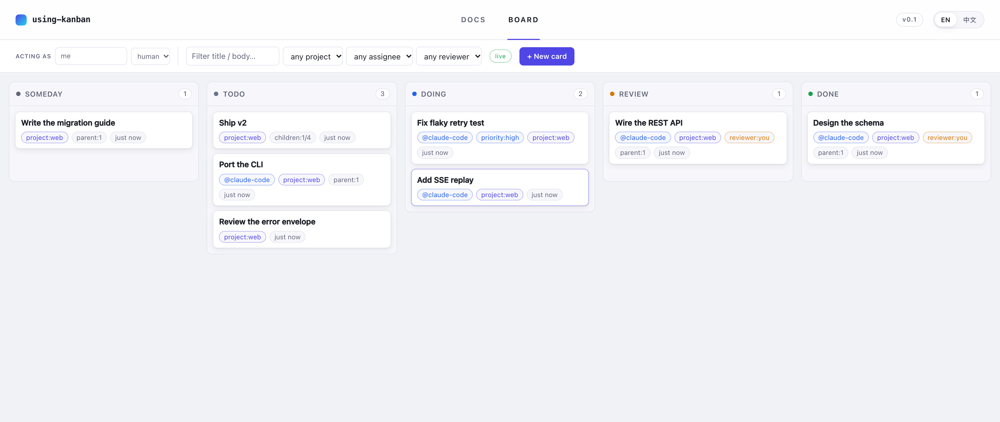
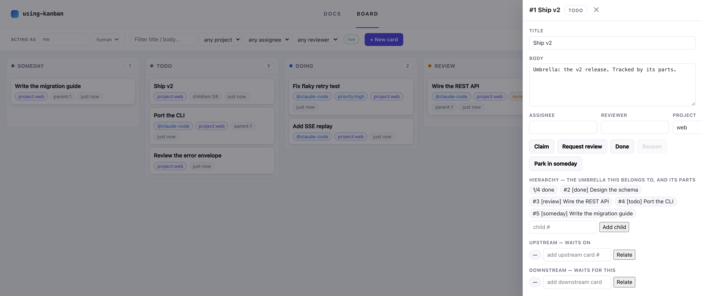

# kanban

> A headless kanban engine for AI agents **and** humans.
> HTTP + SSE + MCP out of the box — bring your own UI.

A human and several agents (Claude Code, Codex, opencode, Pi, …) share one
board. The engine is small and event-sourced, and every surface is a thin client
of the same core: a `ukb` CLI, an MCP server, a Web UI you can drop in, and an
HTTP API your own product can embed. No teams, no daemon — one board per machine.



## Quick start

The packages aren't on npm yet, so run from a checkout:

```bash
git clone https://github.com/wayblink/using-kanban.git
cd using-kanban
pnpm install && pnpm build
npm link ./packages/cli        # puts `ukb` on your PATH
```

```bash
ukb add "Write the OpenAPI spec" --project api --reviewer you
ukb add "Implement /api/cards" --project api --assignee claude-code
ukb board                      # the whole board
ukb web                        # → the Web UI, in a browser
```

Then point your agent at it — this writes the MCP config and a workflow snippet
the harness will actually read:

```bash
ukb init --for claude-code     # or: codex | opencode | pi
```

## The board

Five columns: `someday | todo → doing → review → done`.

| Column    | Meaning                  | How you get there       |
| --------- | ------------------------ | ----------------------- |
| `someday` | parked — meant, not now  | `ukb move <id> someday` |
| `todo`    | ready to pick up         | created here            |
| `doing`   | someone is working on it | `ukb claim <id>`        |
| `review`  | waiting for its reviewer | `ukb review <id>`       |
| `done`    | finished                 | `ukb done <id>`         |

**Claim before you work.** `ukb claim` moves a card to `doing` and assigns it to
you, so nobody duplicates the effort; if someone got there first you get
`claim_conflict`, not a silent overwrite.

**Priorities** are `high · normal · low`, and only order rows inside a column.
"Not now" is not a priority — it is the `someday` column, which takes a card out
of `ukb mine` without calling it finished.

**Dependencies** (`ukb block` / `ukb relate`) mean _cannot start until_. A card
with unfinished upstream work cannot be claimed or moved into `doing`. `done` is
never gated, so a stale blocker can never trap a card.

**Umbrella cards.** A card can be an umbrella — a goal its children support:

```bash
ukb parent 601 --of 38     # #601 is now a part of #38
ukb unparent 601           # top-level again
ukb show 38                # children: 4/6 (…) + the child list
```

One level deep, and separate from dependencies: an umbrella does not block its
parts, a part can be blocked by a third card, and parts may live in another
project. An umbrella with unfinished children cannot enter `doing` or `review` —
it is a container, not a work item.



**Projects** partition one board into many. `--project <slug>` filters every
door; a card with no project matches no filter. `ukb list` prints each project
with its counts.

**Notes** are the paperwork — a remark plus a link to a document:

```bash
ukb note 4 "requirement design doc" --url docs/design.md
```

Local markdown and HTML open in the Web UI's document viewer; `https://` links
open in a tab.

## Front doors

### CLI — `ukb`

Talks to the core in-process: same board, same events, no daemon and no server.

| Command                                                                                                     | Does                                  |
| ----------------------------------------------------------------------------------------------------------- | ------------------------------------- |
| `ukb` / `ukb mine`                                                                                          | your open cards — a call to act       |
| `ukb board [--project p] [--json]`                                                                          | the board, or a project's slice       |
| `ukb show <id>`                                                                                             | detail, history, relations, children  |
| `ukb add "<title>" [--assignee X] [--reviewer Y] [--project p] [--priority high\|normal\|low] [--body "…"]` | create a card                         |
| `ukb claim` / `review` / `done` / `reopen` `<id> [<id> …]`                                                  | move with intent                      |
| `ukb move <id> <someday\|todo\|doing\|review\|done>`                                                        | move anywhere                         |
| `ukb edit <id> [--title/--body/--assignee/--reviewer/--project/--priority]`                                 | change fields                         |
| `ukb block <id> --by <id>` / `ukb unblock`                                                                  | dependency                            |
| `ukb parent <id> --of <id>` / `ukb unparent <id>`                                                           | umbrella ↔ parts                      |
| `ukb relate <id> --with <id> --as upstream\|downstream` / `ukb unrelate`                                    | dependency, named direction           |
| `ukb note <id> "…" [--url …]` / `ukb note-edit` / `ukb note-remove`                                         | remarks and document links            |
| `ukb list`                                                                                                  | every project and its counts          |
| `ukb delete <id> [<id> …]`                                                                                  | creator only                          |
| `ukb web` / `ukb init --for <framework>` / `ukb doctor`                                                     | UI / wire a harness / check the setup |

`done`, `review`, `reopen` and `delete` take several ids; the run stops at the
first card the board refuses, so what you saw is what was applied.

### Web UI

`ukb web` starts the API and the UI and opens a browser. Drag a card between
columns and the drop runs the matching verb (`claim`, `review`, `done`,
`reopen`, or a `move` onto _Someday_); the card drawer edits fields, relations,
the hierarchy and notes, and shows the event history. It is live over SSE —
changes made by an agent or the CLI appear without a refresh. The same page
serves its own docs at `/`, which is the friendliest thing to leave open for a
newcomer.

It is one self-contained file with no framework and no build step:

```bash
node packages/web/scripts/inline.mjs              # → dist/index.html
ukb-server --dir ~ --ui ./packages/web/dist
```

### MCP — 22 tools

`ukb-mcp` is one stdio server exposing the board to any MCP-capable agent. The
workflow lives in the tool descriptions (`kanban_my_cards` reads as a call to
act), so an agent that never sees your docs still claims before it starts.

| Tools                                                                              | For                              |
| ---------------------------------------------------------------------------------- | -------------------------------- |
| `kanban_my_cards` / `kanban_review_queue`                                          | your work, and your review queue |
| `kanban_board` / `kanban_projects` / `kanban_show`                                 | read the board                   |
| `kanban_add` / `kanban_edit` / `kanban_delete`                                     | cards                            |
| `kanban_claim` / `kanban_review` / `kanban_done` / `kanban_reopen` / `kanban_move` | transitions                      |
| `kanban_block` / `kanban_unblock` / `kanban_relate` / `kanban_unrelate`            | dependencies                     |
| `kanban_parent` / `kanban_unparent`                                                | umbrella ↔ parts                 |
| `kanban_note_add` / `_update` / `_remove`                                          | remarks and document links       |

Plus the `kanban://board` resource. `ukb init --for <framework>` writes the
config for you; `--local` points it at this checkout instead of npm.

### Pi panel

`ukb init --for pi` registers the Pi package, which contributes a native `ukb`
tool (and a `/ukb` slash command) plus the skill. On demand, `/ukb gui show`
mounts a panel above the editor, scoped to the current Git project:

```
● ukb · using-kanban · 2 doing · 2 review · 3 todo
├─ [doing][high]    #1 Fix flaky retry backoff test        @pi
├─ [todo][normal]   #4 Add terminal sanitizer to the CLI   @pi
├─ [todo][low]      #5 Umbrella: sanitize the renderers    ▸1/3
  ├─ [todo][normal]   #6 Split the sanitizer out of render @pi
  └─ [review][normal] #7 Cover CJK width                 → jyxc
└─ [review][normal] #3 Overlay widget above the editor     → human
```

An umbrella's children follow it, indented one level, wherever they are in the
flow. Which states the panel shows is a setting: `overlay.states` in
`~/.config/ukb/config.json`, `UKB_OVERLAY_STATES`, or `states=…` for one
session. The default is `doing`, `todo`, `review`, `someday` — the shelf is
visible, history is not.

## Storage, identity and config

- **One board per machine**, at `~/.ukb/`. Every project shares it, separated by
  the `project` field; `--dir` / `UKB_DIR` points elsewhere.
- **Storage**: SQLite (default, WAL — safe appends from several processes),
  `--storage jsonl` (zero deps, git-friendly), or `memory` (tests).
- **Identity**: every event carries an actor. `--agent <name> --agent-type
human|agent` (or `UKB_AGENT` / `UKB_AGENT_TYPE`); the Web UI has an "acting as"
  box. Humans and agents share one namespace.
- **Config**: `~/.config/ukb/config.json` (or `$XDG_CONFIG_HOME/ukb/config.json`)
  sets the default agent, the Pi tool's prompt copy (`guidance`), and the panel
  (`overlay`). Environment variables override the file.

Reads never create a board: with no `~/.ukb/`, `ukb board` fails with
`board_not_found` rather than reporting an empty board — "no work here" and "not
started" are different answers, and an agent cannot tell them apart otherwise.

## Embed it

The API is the product. `createKanbanHandler` is a plain `(req, res) => void`
you can drop into any host:

```ts
import { createServer } from "node:http";
import { createKanbanHandler } from "@wayblink/using-kanban-server";

const handler = createKanbanHandler({ dir: ".", token: "my-fixed-token" });
createServer(handler).listen(8080);
```

```
GET    /api/board                     columns + cards
GET    /api/cards?state=open&assignee=me&reviewer=me&q=text
GET    /api/cards/:id                 card + event history
POST   /api/cards                     { title, body, assignee, reviewer, blockedBy }
PATCH  /api/cards/:id                 edit fields
POST   /api/cards/:id/{claim,review,done,reopen,move}
POST   /api/cards/:id/{parent,unparent}   umbrella ↔ parts (one level)
POST   /api/cards/:id/{block,unblock}     { blockedBy }
POST   /api/cards/:id/{relate,unrelate}   { other, direction }
POST   /api/cards/:id/notes           { text, url }
GET    /api/doc?path=…                the document behind a note's link
GET    /api/events                    SSE stream of the log
GET    /openapi.json                  full spec
```

Errors are `{ "error": { "code", "message" } }` with stable codes —
`invalid_input`, `card_not_found`, `invalid_state`, `claim_conflict`,
`forbidden`, `revision_conflict` — so a caller can branch without parsing prose.
Mutations carry an actor (`X-Actor-Name` / `X-Actor-Type`) and an optional
`If-Match: <revision>` for optimistic concurrency.

## Packages

| Package                         | What it is                                               |
| ------------------------------- | -------------------------------------------------------- |
| `@wayblink/using-kanban-core`   | Event-sourced engine: log, projection, transition guards |
| `@wayblink/using-kanban-cli`    | `ukb` binary + `ukb init` installers                     |
| `@wayblink/using-kanban-server` | REST + SSE API, token auth, OpenAPI, static UI hosting   |
| `@wayblink/using-kanban-web`    | The default Web UI — one self-contained file             |
| `@wayblink/using-kanban-mcp`    | MCP stdio server — the multi-framework front door        |

Storage is swappable and the log is append-only; the board is a projection you
can rebuild by replaying it, which is what gives you history, live updates and
multi-process safety for free. A card's id is the id of its `card.created`
event, so ids are stable and monotonic.

## Development

```bash
pnpm install
pnpm test         # vitest, per package
pnpm typecheck    # tsc --noEmit
pnpm lint         # eslint
pnpm format       # prettier
pnpm build        # tsup
```

Two browser harnesses check the real UI: `pnpm --filter
@wayblink/using-kanban-web browser-check` (zero-dependency CDP driver) and
`drag-check` (Playwright, real HTML5 drag & drop).

## License

MIT
