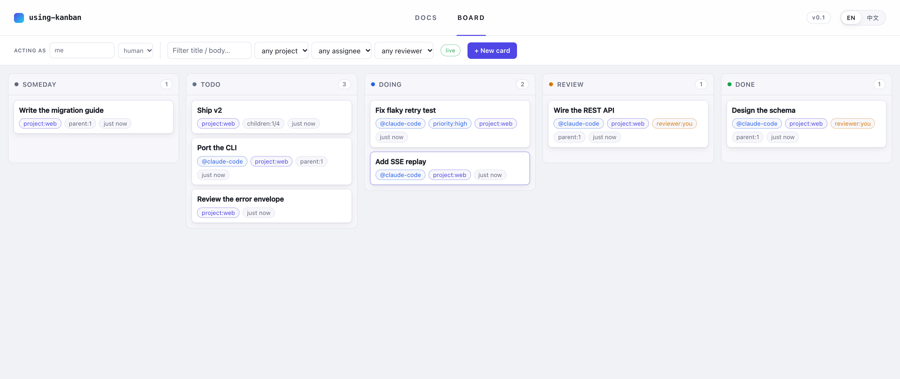
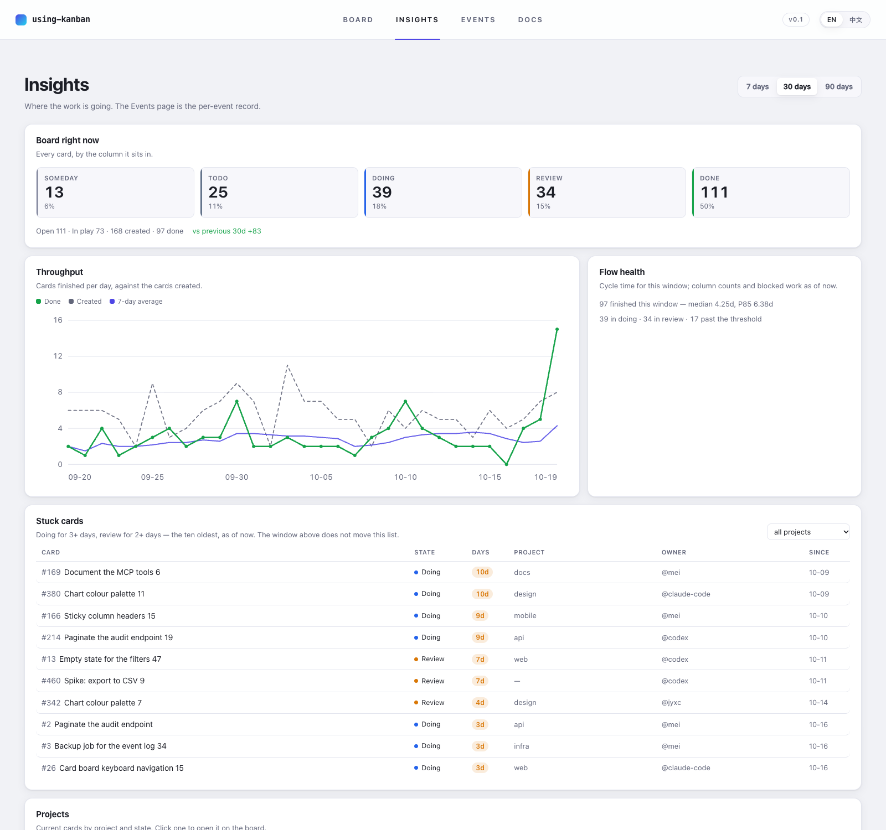
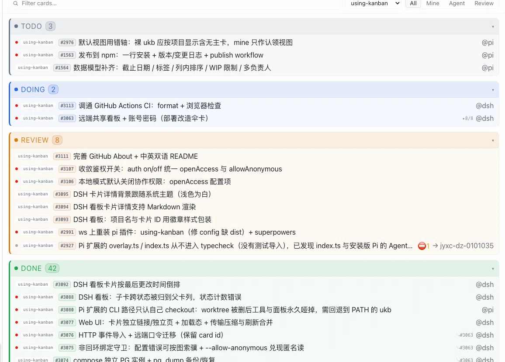

# using-kanban

[English](README.md) | 简体中文

[](https://github.com/wayblink/using-kanban/actions/workflows/ci.yml) [](https://github.com/wayblink/using-kanban/actions/workflows/release.yml)

Using Kanban 是一块给人和编程 agent 共用的看板。你可以在浏览器里创建和分配工作，让 agent 从它所在的 harness 认领卡片，再在同一块看板上验收结果。它既可以只在本机运行，也可以部署成通过 HTTPS 访问的共享看板。



## 快速开始

用 Node.js 20+ 和 pnpm 10 从源码构建。

```bash
git clone https://github.com/wayblink/using-kanban.git
cd using-kanban
pnpm install --frozen-lockfile
pnpm build
(cd packages/cli && npm link)
```

```bash
ukb add "修复登录校验" --project web --subproject auth --assignee codex
ukb board --project web
ukb web
```

`ukb add` 第一次写入时会自动创建本地看板。默认目录是 `~/.ukb/`；要换位置就传 `--dir <dir>` 或设置 `UKB_DIR`。数据库文件在 `<dir>/.ukb/` 下。

## 工作流

开始干活前先读卡片正文里的目标文件和验收标准，**先认领再动手**。认领会把卡片移到 `doing` 并把你设为负责人；如果一张卡已经在 `doing` 且已有负责人，另一个人的认领会返回 `claim_conflict`。

| 状态      | 含义                                                           |
| --------- | -------------------------------------------------------------- |
| `todo`    | 新工作从这里开始。`ukb reopen <id>` 可以把已完成的卡打回重做。 |
| `doing`   | 负责人用 `ukb claim <id>` 开始处理。                           |
| `review`  | 负责人用 `ukb review <id>` 移交评审。                          |
| `done`    | 评审人用 `ukb done <id>` 验收完成。                            |
| `someday` | `ukb move <id> someday` 把它搁置，同时清空负责人和评审人。     |

`ukb mine`（或直接 `ukb`）列出你名下未完成的工作。`ukb show <id>` 会显示正文、关联和历史。优先级有 `high`、`normal`、`low`，用于同一状态内的排序。

## Web 界面

| 页面         | 能做什么                                                                                                                                                                  |
| ------------ | ------------------------------------------------------------------------------------------------------------------------------------------------------------------------- |
| **Board**    | 按项目、子项目、负责人或评审人搜索和筛选。拖到 Doing 即认领，拖到 Review 移交，拖到 Done 完成，拖到 Todo 打回，拖到 Someday 搁置。看板只拉卡片摘要，并通过 SSE 实时更新。 |
| **Card**     | 编辑字段、关联、子卡和备注，查看卡片历史。`#/card/<id>` 可以直接打开某张卡；**Copy link** 复制一个链接，发给能访问同一块看板的人。                                        |
| **Insights** | 按你所在时区比较 7 天、30 天或 90 天的新建与完成量，查看项目总量、累计流、周期时间中位数和 P85，以及卡在 Doing/Review 的卡片。                                            |
| **Events**   | 按操作者、动作和来源浏览审计日志；项目筛选作用于整个分页日志。                                                                                                            |
| **Docs**     | 在 `#/docs` 阅读英文或中文版产品手册。                                                                                                                                    |



## CLI 与卡片组织

运行 `ukb help` 查看命令语法，`ukb doctor` 查看当前配置和身份。

- **项目。** 用仓库名作为 `project`，用 `auth` 这样的工作流名作为 `subproject`；有子项目就必须有项目。`ukb list` 显示各项目卡片数，`ukb board --project web --subproject auth` 只看一个工作流。
- **依赖。** `ukb block 2 --by 1` 让 #2 等待 #1；`ukb relate 2 --with 1 --as upstream` 表示同一条边。依赖未完成时，卡片不能进入 Doing。
- **伞卡。** `ukb parent 2 --of 1` 让 #2 成为 #1 的一部分。伞卡可以跨项目任意嵌套；父卡在 Doing 时，子卡可以进入 Doing 或 Review；子卡全部完成后，伞卡才能进入 Review 或 Done。卡片之间的依赖是独立配置的。
- **备注。** `ukb note 2 "设计文档" --url docs/design.md` 添加一条带链接的备注。Web UI 可以渲染服务端工作目录、store 目录或 `--doc-root` 配置目录下的本地文档。

## Agent 集成

先构建并 link 好 checkout，然后**在希望 agent 工作的项目目录里**运行安装命令；配置完记得重启 harness。MCP 安装器支持用 `--local` 指向这份构建，用 `--dry-run` 预览改动。

| Harness          | 安装方式                                                                    | 增加什么                                                                                            |
| ---------------- | --------------------------------------------------------------------------- | --------------------------------------------------------------------------------------------------- |
| Codex            | `ukb init --for codex --local`                                              | 在 `~/.codex/config.toml` 增加 stdio 的 `using-kanban` MCP 条目，并在 `AGENTS.md` 写入工作流说明。  |
| Pi               | `ukb init --for pi`                                                         | 在 `~/.pi/agent/settings.json` 安装本地 `packages/pi` 扩展和 skill，并在 `AGENTS.md` 写入项目说明。 |
| DeepSeek Harness | `ukb init --for dsh`，然后在 **Plugins → Add plugin** 里添加 `packages/dsh` | 在 `AGENTS.md` 写入项目说明，并从已安装 bundle 获得原生工具和 UI。                                  |
| Claude Code      | `ukb init --for claude-code --local`                                        | `.mcp.json` 和 `CLAUDE.md`。                                                                        |
| opencode         | `ukb init --for opencode --local`                                           | `opencode.json` 和 `AGENTS.md`。                                                                    |

### Codex

MCP 安装会以 `codex` 这个 agent 身份暴露 `kanban_*` 工具。用 `codex mcp list` 检查条目，然后让 Codex 列出它未完成的看板卡片。[Codex MCP 文档](https://learn.chatgpt.com/docs/extend/mcp?surface=cli)

**Codex Desktop 插件预览。** 如果你已经从本地 `using-kanban` marketplace 安装了 **Using Kanban**，可以从对话的应用菜单打开 **Show board**，或让 Codex 显示当前项目的看板。MCP App 会按状态分组、嵌套子卡、按项目/负责人/文本筛选，并打开卡片详情和历史。用 **Refresh** 拉取变化，用 Codex 工具操作卡片，用 Web UI 做交互编辑。

从源码安装桌面插件需要包含 `packages/codex` 和 `.agents/plugins/marketplace.json` 的预览构建。构建和运行插件要用同一个 Node 版本，因为 SQLite 是原生 addon；桌面应用还必须能在 `PATH` 里找到 `node`。先执行 `pnpm install --frozen-lockfile` 和 `pnpm build`，再在预览 checkout 里运行：

```bash
pnpm --filter @wayblink/using-kanban-mcp deploy --legacy --prod packages/codex/dist/server
codex plugin marketplace add "$PWD"
codex plugin add using-kanban@using-kanban
```

每个会话只选一种连接方式：桌面插件或 MCP 条目，不要同时开。标准 checkout 用 `ukb init --for codex --local` 就能直接提供工具。[Codex 插件命令](https://learn.chatgpt.com/docs/cli/reference#codex-plugin)

### Pi

原生 `ukb` 工具和 skill 会教会 agent 这套工作流。默认 agent 身份是 `pi`。`/ukb` 列出你的卡片，`/ukb gui show` 打开一个默认按当前 Git 项目过滤的终端面板；`/ukb gui split` 开第二栏，`/ukb gui help` 查看显示选项，`/ukb web` 打开 Web UI。配置了远端看板时，它会用默认浏览器打开对应服务器；本地看板则会在后台启动 Web UI，`/ukb web stop` 停止。

### DeepSeek Harness

先写入工作流片段，再在 DSH 里安装 bundle。bundle 提供原生 `ukb` 工具、`/ukb` 命令和系统提示词说明，并以 `dsh` 身份运行 CLI。如果它找不到可执行文件，设置 bundle 的 `ukb_path` 或环境变量 `UKB_BIN`。Web 客户端会增加 **Kanban** 侧栏、带状态计数的 composer chip，以及工具调用的卡片/看板视图。侧栏和 chip 默认按会话工作区路径匹配项目，匹配不到时显示全板。[DeepSeek Harness 安装](docs/dsh-integration.md#install)



### 其他 MCP 客户端

`ukb-mcp` 是一个 stdio server。从已构建的 checkout 启动时，把命令设为 `node`，参数为 `/path/to/using-kanban/packages/mcp/dist/bin.js --agent <name>`。它提供列出我的任务和评审队列、读卡、状态流转、依赖、伞卡、备注等工具，以及 `kanban://board` 资源。

## 本地与共享看板

### 存储、身份与访问控制

- 本地默认使用 SQLite；也可以用 `--storage` 或 `UKB_STORAGE` 选择 JSONL、内存或 Postgres。Postgres 的连接串来自 `--pg-url`、`UKB_PG_URL` 或 `DATABASE_URL`。看板及其历史都由 append-only 的事件日志推导出来；卡片 ID 和事件 ID 是两套独立序列。
- 本地 CLI 和浏览器默认以看板 owner 身份操作。在 `~/.config/ukb/config.json`（或 `$XDG_CONFIG_HOME/ukb/config.json`）里设置 `owner`，或用 `UKB_OWNER` 覆盖。CLI 支持 `--agent <name> --agent-type agent` 以 agent 身份操作。Pi 也从同一份配置读取 `guidance` 和 `overlay`。把 `auth` 设为 `false` 会同时关闭登录/账号检查和每张卡的 creator/assignee 权限，仅适合个人看板；共享服务器请保持默认开启。
- 卡片的编辑权限给 creator、assignee 和看板 owner；删除权限给 creator 和 owner。`auth` 一个开关同时控制登录和这层权限：个人看板可在配置里写 `auth: false`（或 `--auth off` / `UKB_AUTH=off`）；共享看板请保持开启。服务器上 `auth: off` 还会接受匿名写入，因此只能在可信主机上使用。
- 以上权限是协作约定，不是密码学隔离；真正对外时请配合账号和 HTTPS。

### 运行共享服务器

服务器默认只绑定 loopback。没有账号时，loopback 读是开放的，写需要服务器 token。要绑定到 loopback 之外，需要先建账号；除非显式关闭 `auth`——那会同时开放读写，只适合个人/可信看板，绝不能用于公网。

配置账号后，浏览器使用 HTTP Basic 登录，自动化脚本可以使用机器令牌。用户和令牌都在运行 store 的主机上创建。`/healthz` 始终可供探针访问。

```bash
ukb user add alice
ukb user token add alice --label laptop
```

共享看板请通过 HTTPS 提供服务。仓库里的 Docker Compose 栈会在 Caddy 后面运行 Web UI 和 API，使用 Postgres 并带备份脚本。启动前先配置 `.env` 并创建第一个账号。[部署手册](docs/deployment.md) · [账号与鉴权](docs/shared-board-accounts.md)

### 连接客户端

用 `--server`、`UKB_SERVER` 或共享配置里的 `"server"` 设置看板地址；用 `--token`、`UKB_TOKEN` 或 `ukb login` 提供机器令牌。登录会把对应服务器的令牌保存到配置文件旁的 `credentials.json`。

```bash
ukb login --server https://board.example.com --token 'ukb_…'
ukb --server https://board.example.com board --project web
```

MCP server、Pi 和 DeepSeek Harness 使用同一份设置。如果要设成远端默认，先运行 `ukb init`，再让 harness 进程能访问同一份配置和凭据。`ukb web`、`ukb init`、`ukb doctor`、`ukb user`、`ukb migrate` 这些命令需要本地模式。

### 迁移已有看板

`ukb migrate --to postgres` 把本地 SQLite 事件日志复制到 Postgres。要上传到正在运行的看板，在目标端开启 `UKB_ALLOW_IMPORT=1`，然后在源机器上用 admin 机器令牌运行 `ukb migrate --to https://board.example.com --token 'ukb_…'`。两条路径都会保留卡片和事件 ID，默认要求目标为空。[迁移步骤](docs/deployment.md#9-migrating-an-existing-sqlite-board)

## 排障

- **`board_not_found`。** 检查 `UKB_DIR` 和当前看板地址；本地看板还没初始化的话，先 `ukb add` 建第一张卡。
- **`unauthorized`。** 共享看板先在浏览器登录，或检查 CLI 的机器令牌和服务器地址；本地 `ukb web` 使用启动时打印的 URL。
- **`forbidden`。** 检查当前 actor 和卡片的 creator/assignee；看板 owner 可以编辑和删除任意卡片。个人看板可以设 `auth: false`（或 `--auth off`）取消这层限制。
- **`revision_conflict`。** 重新加载卡片后再提交修改。

## 开发

```bash
pnpm build
pnpm typecheck
pnpm lint
pnpm test
pnpm --filter @wayblink/using-kanban-web browser-check
pnpm --filter @wayblink/using-kanban-web drag-check
```

工作区包含看板引擎与存储（`packages/core`）、共享配置（`packages/config`）、CLI、MCP 和 HTTP server、Web UI，以及 Pi 和 DeepSeek Harness 适配层。Web UI 构建产物是单个内联了资源的 `index.html`。

## License

[MIT](LICENSE)
