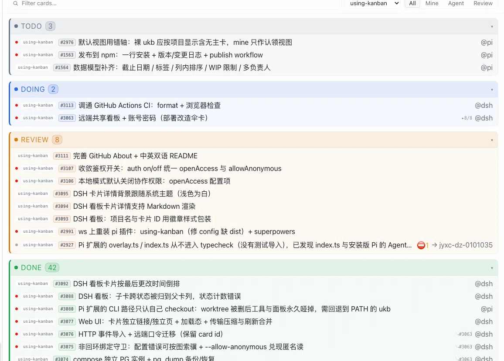

# DeepSeek Harness integration

DeepSeek Harness (DSH) gets the board through `packages/dsh`, a normal DSH
bundle: one native `ukb` tool, a `/ukb` command, the board guidance in the
system prompt, and a Kanban panel whose Full board button starts the full Web UI. It is the counterpart of the Pi extension, not a second board
implementation — every call runs the `ukb` CLI, so validation, transitions,
attribution and error codes stay in one place.



## Install

```bash
ukb init --for dsh          # writes the AGENTS.md workflow snippet
```

Then install the bundle directory in DSH: **Plugins** → **Add plugin** →
`packages/dsh` in this checkout. DSH links the directory into its profile, so a
`git pull` is live after DSH reloads. There is no MCP config to merge: the bundle
registers the tool directly.

`ukb init --for dsh --dry-run` prints what it would write.

## Why a bundle and not the MCP server

The MCP server (`ukb-mcp`, 22 tools) is a complete door too, and it needs nothing
but a config row. The bundle exists for the part MCP cannot do: put the board
rules in the system prompt _before_ the model decides whether it needs a todo
list at all, and expose the whole board as **one** tool schema instead of 22.
A model that never reads a skill never learns that `claim` comes before work; a
model that sees nine paragraphs of board discipline up front does.

## What the tool exposes

`action` plus the same fields the CLI takes: `id`/`ids`, `title`, `body`,
`column`, `priority`, `assignee`, `reviewer`, `blockedBy`, `project`, `other`,
`parent`, `direction`, `noteId`, `text`, `url`, `json`, `brief`.

Ids are positional and batchable exactly as on the command line
(`done 1 2 3`), because turning a set of ids into flags would invent a second
grammar for the same operation.

## CLI resolution

The DSH executable is Electron, whose embedded Node cannot load a native addon
built for the system Node. This was observed in practice: better-sqlite3 failed
with `NODE_MODULE_VERSION 147` vs `149`. So the bundle runs the checkout's
`packages/cli/dist/bin.js` with a real Node, resolved in this order:

1. `ukb_path` in the bundle config, or `$UKB_BIN` (an executable).
2. `$UKB_NODE`, then `node` on the host's PATH, then `/opt/homebrew/bin/node`,
   `/usr/local/bin/node`, `~/.local/bin/node`.
3. The runtime Node shipped beside the DSH desktop executable.
4. `ukb` on PATH, then the usual install locations.
5. Electron as Node — last, and it warns that native addons may not load.

The chosen source is logged when the bundle loads (`[ukb] using …`).

## Differences from the Pi extension

| Pi                                               | DSH                                                 | Why                                                                                                              |
| ------------------------------------------------ | --------------------------------------------------- | ---------------------------------------------------------------------------------------------------------------- |
| overlay panel above the editor                   | the Kanban panel's Full board button, or `/ukb web` | DSH plugins render through slots, not a TUI pane                                                                 |
| per-turn board digest via `before_agent_start`   | not implemented                                     | DSH has no pre-turn hook guaranteed to land before the turn's first step, so a digest would arrive one step late |
| rendering truncation in the TUI                  | the tool result is bounded at 24,000 chars          | DSH puts tool results into context verbatim                                                                      |
| `pi.exec`                                        | `child_process.spawn` with the resolved Node        | see CLI resolution                                                                                               |
| `/ukb web` opens the URL / starts a local server | the same, from the panel button or `/ukb web`       | both read the URL out of the CLI's banner; the process is started detached                                       |

## Full board (ukb web)

The Kanban panel's **Full board ↗** button starts `ukb web` the way the CLI
intends and opens the result in a new tab:

- the Host spawns the resolved CLI detached and reads the URL from its banner —
  the port may be OS-assigned and the token is generated per launch, so only the
  process knows its address;
- the server is reused until it exits, so repeated clicks open the same tab;
- with a remote board (`server` in `~/.config/ukb/config.json`, or `$UKB_SERVER`),
  the button opens that server instead: `ukb web` is a local-mode verb;
- a server the bundle started is stopped when the bundle unloads; one started by
  hand is not touched.

`/ukb web` performs the same launch and answers with the URL instead of opening
a tab; `/ukb web stop` stops the server this Host started.

## Troubleshooting

| Symptom                                | Cause                                                             | Fix                                                                                         |
| -------------------------------------- | ----------------------------------------------------------------- | ------------------------------------------------------------------------------------------- |
| `ukb CLI not found`                    | no CLI in the checkout or on PATH                                 | build `packages/cli`, or set `ukb_path`                                                     |
| `better-sqlite3 … NODE_MODULE_VERSION` | the Electron Node loaded a native addon built for the system Node | set `UKB_NODE` to the Node you use for the CLI, or rebuild the addon                        |
| `forbidden` on claim/edit              | the card belongs to someone else                                  | set `auth: false` for a personal board, or `show` the card and let its creator/assignee act |
| Board JSON truncated                   | the tool result cap                                               | use `board` without `json`, or a `--project` slice                                          |
| Full board reports an error            | the CLI's `web` verb failed to serve or to print its URL          | run `ukb web --no-open` once in a terminal to see its own output                            |
